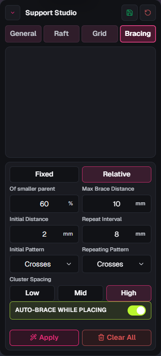

# Support Studio Stage 1: bracing acceptance

Status: **authorized on 2026-10-16; implementation and verification in progress; awaiting user acceptance.** This is a separately authorized tools sequence on the unpublished 0.4.1 integration candidate. [Phase 0.5](upstream-0.1.17-acceptance.md) remains awaiting acceptance. No release or version bump is authorized by this stage.

## Scope

Retain legacy fixed sizing and add parent-relative uniform brace sizing, plus optional automatic bracing while manually placing trunks and branches. Retain existing patterns, Cluster Spacing, Apply/Clear, and manual brace editing. The next stages remain deferred in the [fork roadmap](fork-roadmap.md).

## Acceptance checks

The status column distinguishes automated evidence from pending manual checks.
The actual methods and limitations are recorded below.

| Area | Required behavior | Status |
| --- | --- | --- |
| Fixed sizing | Existing fixed-diameter behavior, including legacy endpoint geometry, remains the default. Existing settings and presets retain that behavior. | Automated checks passed; manual/native review pending |
| Relative sizing | Each brace diameter equals the smaller actual parent shaft segment diameter at its two attachment points multiplied by the entered percentage. Cover unequal parent diameters and attachments on different segments; the new relative brace itself stays uniform. | Automated checks passed; manual/native review pending |
| Settings | Mode, fixed diameter, percentage, and the live-placement option survive the intended settings/preset round trips; missing fields retain compatible defaults. Invalid imported values cannot produce invalid geometry. | Automated and browser save/reload checks passed |
| Apply/Clear | Existing brace patterns and Cluster Spacing retain their behavior. Apply preserves manual braces and supports explicit regeneration for two eligible shafts. Clear All retains its existing behavior: it deletes all braces on the current model, including manual braces, while leaving other models alone. Undo/redo restores a consistent support graph. | Automated checks passed; manual/native review pending |
| Live placement | The option starts off. When enabled, manually placing an eligible trunk or branch generates braces using current pattern and sizing settings. Existing supports of other models or plates are excluded. Placing with the option off retains existing behavior. | Automated checks passed; manual/native placement pending |
| History | One undo removes the placed trunk or branch and its newly generated braces; one redo restores both. Existing or manually created braces remain intact during live placement. | Automated checks passed; manual/native undo/redo pending |
| Integration | TypeScript, focused automated checks, documentation accuracy, and relevant lint/localization checks pass. Record any GUI checks separately from automated checks. | Automated checks passed as recorded below; native build pending |
| Regression boundary | Manual brace placement/editing, existing support placement families, plate isolation, and legacy settings remain usable. Later tools are not introduced in this stage. | Broad automated suite passed; manual/native regression review pending |

## Checks actually performed

On 2026-10-16:

- The broad support-system and scene VOXL automated suites passed **843/843 tests** after correcting a regression in automatic placement's two-support behavior. The default builder and automatic-support integration retain their three-support minimum; explicit Apply and local manual placement support two eligible shafts.
- Automated coverage includes relative diameter resolution and invalid-parent fallback; uniform relative geometry and legacy endpoint geometry; settings, preset, and scene serialization; local generation and history; and existing support/VOXL behavior. These checks exercise synthetic data and application contracts, not native pointer placement or physical printing.
- The focused bracing controls DOM test passed (**1 test**), covering Fixed/Relative state, the default 50% value, live bracing off/on, preservation of fixed settings, and the existing pattern/Apply/Clear controls.
- TypeScript's no-emit check passed. The clean-directory lint check passed **42 directories with 0 errors and 0 warnings**. The localization literal check passed **59 paths and 163 files**, after test selectors received the documented ignore comments. Documentation accuracy passed **167 documents**.
- Headless Edge QA exercised the actual application with a synthetic cube: import, Support Studio bracing controls, the Fixed default and live option off, switching to Relative with 50%, entering 60%, turning live bracing on, and explicitly saving settings. Reloading and reimporting the model restored the actual Relative 60% and live-on controls as well as the stored settings. Visual review at **1280 × 800** confirmed all bracing controls remained visible without clipping. There were no uncaught page errors; the development session logged an inherited, unrelated TopBar hydration warning.
- The production frontend compile completed during the Windows package build. Native Rust compilation was still running when this record was updated, so the native build remains pending.

## Browser review image

This image shows the actual compact application UI with a synthetic model. It
records the settings review, not manual support placement or print strength.

[Open the review image](assets/fork-support-studio/stage-1-bracing.png).

Native build, manual/native support placement and undo/redo, physical printing,
and explicit user acceptance remain pending. Planned checks are not completed
results. This feature makes no claim about physical print strength or printer
behavior.
