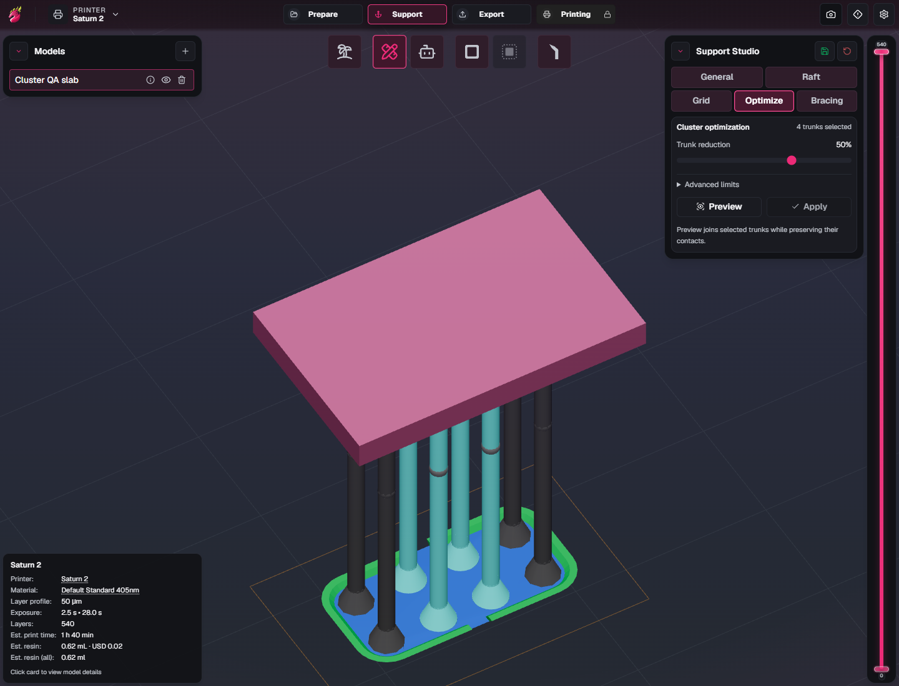
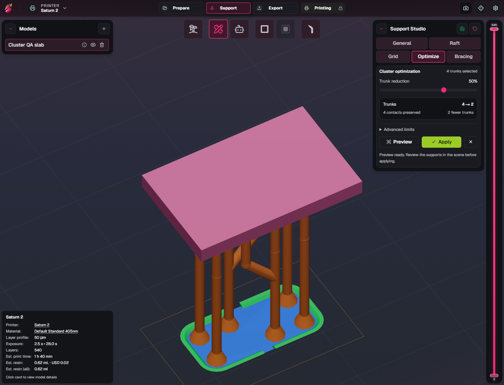
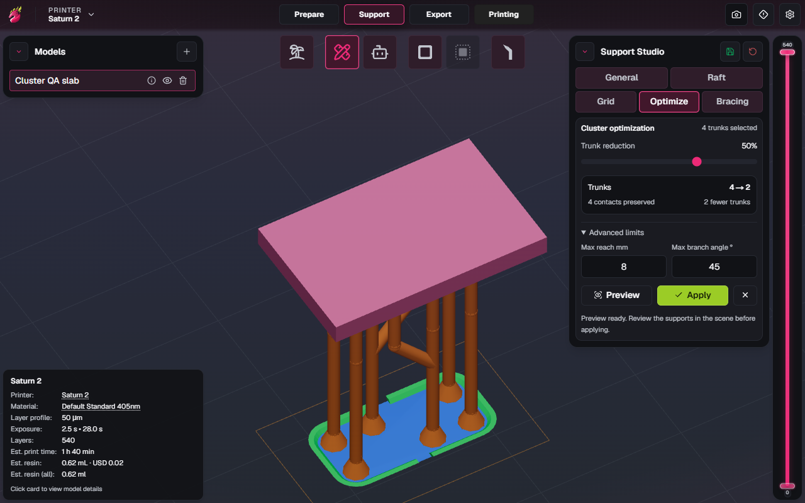

# Support Studio Stage 2: Cluster Optimization acceptance

Status: **implemented; automated checks, optimized frontend browser review, and Windows build passed; combined review continues; actual-scene Preview is operable, with reported geometry quality under review.** Stage 2 was explicitly authorized by the user on 2026-10-16 after accepting Stage 1. Detailed manual/physical-print scenarios remain unverified. This record does not mark planned checks as passed. The installed review build remains `0.1.17 · stickninja r2`, package `0.4.2`. On 2026-10-17 the user authorized unpublished r3/package 0.4.3 for the continued geometry correction; its build and installation remain pending. Earlier build checks below apply to their recorded packages. The r2 build passed, and native About plus running-executable identification confirmed r2 in the normal installation; on 2026-10-16 the user confirmed Optimize Preview is operable on the actual scene in normal r2, resolving the blocked control, then reported strange support geometry. Geometry quality remains under review; this is not a broad optimization pass or acceptance. Actual-scene Cancel/Apply/Undo/Redo and explicit Stage 2/3 acceptance are not established by that confirmation. See the latest [Stage 3 follow-up evidence](support-studio-grid-acceptance.md#r2042-candidate-build). [Phase 0.5](upstream-0.1.17-acceptance.md) remains awaiting acceptance and no release is authorized. On 2026-10-16 the user authorized Stage 3 to proceed for combined Stage 2/3 review; this is an explicit sequencing exception, not Stage 2 acceptance. See [Stage 3 acceptance](support-studio-grid-acceptance.md).

## Scope

Reduce eligible selected grounded trunks by attaching their existing model contacts as branches to retained trunks, using DragonFruit's existing branch, knot, and collision contracts. Preserve every model contact's position and contact geometry. Keep the change within the selected model and its assigned plate, and keep unrelated support graphs intact. Safety takes precedence over reaching a target reduction: unsupported or blocked conversions must remain unchanged and be reported.

This stage does not implement Grid Optimization, Advanced Placement, or support influence. Existing Stage 1 bracing settings and placement behavior remain available. See the [fork roadmap](fork-roadmap.md) for the acceptance order.

## Acceptance checks

The evidence section records completed automated and browser checks. Detailed
native/manual scenarios and production/build checks remain pending where stated.
Automated synthetic fixtures, browser checks, user reports, native checks, and
physical printing must be distinguished.

| Area | Required behavior | Status |
| --- | --- | --- |
| Selected-trunk reduction | An eligible selected cluster produces fewer grounded trunks and corresponding branches on retained hosts. A selection with fewer than two eligible trunks, or no valid conversion, gives an understandable result without modifying the graph. Unselected trunks cannot be silently converted or used outside the intended selection. | Automated checks passed; development browser preview verified; native/manual review pending |
| Contact preservation | Compare all before/after model contacts, including position, orientation, tip profile, diameter, penetration, and contact-cone geometry. Converted contacts and retained contacts match; count reduction never drops or moves a model contact. | Automated checks passed; native/manual review pending |
| Existing graph contracts | New branches attach through valid knots on retained host shafts, with valid segment references, normalized attachment position, consistent host diameter, and normal branch geometry. Apply, editing, and export leave no dangling references or detached attachments. | Automated checks passed; native/manual review pending |
| Collision and routing | Use existing segment, branch, and model-clearance contracts for a conservative straight diagonal graft. Valid nearby candidates can reduce; blocked connections, unsuitable contact geometry, and invalid or missing geometry fail safely. A refusal preserves the original trunk and contact. Full pathfinding around obstacles is outside this implementation. | Automated checks passed; native/manual review pending |
| Ownership | Mixed-model selections, inactive or changed plates, and model reassignment cannot connect different models or plates. Supports belonging to other models/plates are unchanged. | Automated checks passed; native/manual review pending |
| Dependents and braces | Existing branches, leaves, knots, kickstands, and manual/automatic braces attached to candidate trunks are preserved through a proven safe conversion or cause that candidate to be skipped. Verify both endpoints and host links; no manual brace may disappear as an incidental cascade. | Automated checks passed; native/manual review pending |
| Preview and cancellation | Preview reports proposed reduction and skipped candidates without changing supports, selection, history, settings, or serialized scene data. Refreshing, dismissing, or repeating preview is safe. A no-op cannot create a history entry. | Automated checks and development browser preview scenarios passed; native/manual review pending |
| Stale proposal | Editing supports, selection, settings, model transforms, mesh, or plate context after preview invalidates the proposal or requires a fresh preview. Apply must not commit a proposal against a different graph or context. | Automated checks and development browser preview scenarios passed; native/manual review pending |
| Atomic history | Apply commits the complete graph change as one typed support edit. One Undo restores the exact prior graph and contacts; one Redo restores the optimized graph. Repeat cycles preserve valid dependencies and unrelated supports. | Automated and development browser Apply/Undo/Redo checks passed; native/manual review pending |
| Save/reopen | After Apply, save and reopen a scene and compare the optimized supports, contacts, knots, ownership, and braces. Legacy scenes and Stage 1 settings remain compatible. Preview itself is not persisted. | Automated binary VOXL roundtrip passed; browser/native save-reopen pending |
| Production UI and localization | Controls, feedback, disabled/no-op/stale states, counts, and units are readable in the optimized frontend. Extract and compile new messages for all catalogs; verify compact production IDs resolve without source-message fallbacks. Check panel visibility at a compact window size. | Compiled catalog tests and optimized frontend browser checks passed, including compact panel |
| Integration and build | Record focused core/DOM tests, regression checks for support/scene serialization, TypeScript, relevant lint/localization gates, documentation accuracy, optimized frontend build, and any Windows build actually performed. | Automated/type/lint/docs gates, optimized frontend, and Windows x64/NSIS build passed; installation pending |

## Checks actually performed

On 2026-10-16, a synthetic VOXL fixture was generated with the actual trunk builder and binary scene codec: an elevated 22 × 14 × 2 mm slab, eight ordinary 1.2 mm trunks contacting its underside at Z = 25 mm, and a 4 mm contact grid. Codec parsing confirmed eight trunks, eight roots, and the embedded 12-triangle slab mesh. The pure planner run with 50% reduction, 8 mm reach, and 45° from vertical returned four converted trunks, four remaining trunks, eight contacts before and after, and no skips. This is a fixture preparation smoke check, not a browser/native placement, Apply/history, save/reopen, or detailed geometry acceptance check. The fixture and its helper remain outside the repository.

### Automated integration evidence

On 2026-10-16 the primary review ran the broad support-system and VOXL suites:
**880/880 tests passed**. The actual binary scene roundtrip uses support export,
VOXL serialization, parse, and store reload, checking exact cone profiles and
normals, graft segments, manual braces, and leaf contact geometry. Dependent
knot world positions are checked within 0.000001 mm. Focused controller coverage
includes preview isolation, staleness (including grid context), post-apply status
clearing on graph/selection/history changes, hover preserving status, and safe
recovery from a planning exception. These are synthetic application-contract
checks, not native pointer or physical-print tests.

The primary DOM run passed **4/4 tests**: three Cluster Optimization cases and
the existing Stage 1 bracing case. The Cluster cases cover controls, summary
clearing after Undo, and readable planning-failure feedback with Apply disabled.
The compact-production-ID catalog regressions passed **12/12 tests** across all
six locales for Stage 1 and Cluster Optimization. Catalog extraction and
compilation were performed; new target-locale translations remain for Crowdin.

TypeScript and focused lint passed. The routine lint gate passed **43
directories**; the localization literal gate passed **60 paths / 164 files**.
Documentation accuracy passed **168 documents** and the whitespace diff check
passed. A synthetic selection of **1500 distant trunks** performed zero host
checks and zero geometry queries, taking approximately **33–42 ms** in the
observed local runs. This establishes that distant candidates use the spatial
filter, not a general timing guarantee.

### Development browser evidence

The final primary development-browser review passed actual viewport Preview,
Cancel, option-change staleness, Apply confirmation, Undo/Redo, and compact
**1280 × 800** controls. Visual inspection of applied, Undo, and Redo states
confirmed restoration. The latest four-trunk selection reduced to two trunks
with four contacts preserved; another run reduced four to three, a valid partial
reduction. The own-commit confirmation problem found during review was repaired
and the final run reported no uncaught page errors. These are browser checks,
not native installation or physical printing. The UI agent's latest focused run
passed **10 controller tests and 4 DOM tests**, with TypeScript and focused lint
also passing. Optimized frontend checks and the Windows build were subsequently
completed below.

### Optimized frontend evidence

Implementation commit `85b373ac` was built from a clean working tree. The
optimized frontend completed successfully. Primary headless Edge review served
the exact static assets prepared for embedding in the Windows application,
separately from the development server. It passed actual viewport Preview,
Cancel, option-change staleness, Apply confirmation, Ctrl+Z Undo and
Ctrl+Shift+Z Redo, and compact **1280 × 800** controls. The latest run reduced
four selected trunks to two retained trunks, preserving their four contacts;
the whole fixture changed from eight trunks to six. The run reported **zero
uncaught page errors**. Production screenshots were visually reviewed.

These images show the actual optimized frontend and synthetic scene. They
establish the recorded browser workflow, not native installation or print
strength.

### Windows candidate build

The optimized Windows x64 executable and NSIS installer completed successfully
with exit code 0 from implementation commit `85b373ac`. The executable's PE
ProductName is `DragonFruit (stickninja)`, CompanyName is `stickninja`, and
FileVersion and ProductVersion remain `0.4.1`; machine type `0x8664` identifies
x64. Documentation and screenshots follow in a separate documentation commit;
the candidate's application code is the implementation commit above.

The local review candidate is named
`DragonFruit-stickninja-cluster-stage2-x64-setup.exe`, **21,987,099 bytes**,
SHA-256 `A33A78AD96FDC08EA06E93FE8211D56365104B9768E020C507C69E44CFBF630B`.
This is an unpublished build for user review. Installation, native UI behavior,
and physical printing have not been independently verified. No version bump or
release was performed.

Stage 1 evidence remains in its [acceptance record](support-studio-bracing-acceptance.md)
and does not establish Stage 2 behavior.

## Stage 3 shared-controller regression review

During Stage 3 integration on 2026-10-16, the optimized frontend's Cluster
workflow was reviewed again against the exact assets prepared for Windows
embedding. Preview, Cancel, option-change staleness, Apply, Undo, Redo, and
compact layout passed: seven selected trunks reduced to four while preserving
seven contacts, with zero uncaught page errors. This adds browser regression
evidence after the shared preview-controller refactor; Stage 2 remains
unaccepted pending combined review. See [Stage 3 evidence](support-studio-grid-acceptance.md).

### Geometry-quality diagnosis in progress

On 2026-10-17 the user clarified that each screenshot came from running one tool
separately on the original supports. Sequential application is ruled out for
those examples; the exact private-scene graph had not yet been inspected at
that point.

Source review confirmed the original shared graft logic retained a 0.25 mm
first-span stub near the existing top joint, with dependencies able to move the
graft lower. The original planners added connection joints around the preserved
geometry. These details explained redundant small segments and joints, but the
exact private-scene dependency configuration was not established.

The narrow source correction now reuses the original top joint and first segment
when the first span has no hosted knots. Grid retains its required lower leg
and knee. Real or free hosted knots retain the conservative graft path, and
shared-root, kickstand, legacy-dependency, cone, bend, and collision guards remain
in force. The correction does not add global routing, remove free knots, or
redesign long/low joins. Their geometry quality remains unresolved.

Verification passed **77 optimization unit/controller/catalog tests**, including
**44 planner geometry tests**, and **15 ReactCompiler/Lingui DOM tests**. Full
TypeScript and scoped ESLint covering three production and two test files passed
with zero lint warnings. Independent review passed **61 overlapping
planner/controller tests** and found renderer, proxy, and export endpoints
consistent. Coverage includes direct joint/segment reuse, binary save/load,
removal of the old base-joint reference, free/attached-knot preservation,
protected dependencies, cone/bend collisions, deterministic results, and Grid
spacing changes followed by Cluster optimization.

The primary production frontend build completed with exit code 0, including
Next compilation, TypeScript, and prepared embedded frontend assets.
Documentation accuracy passed for **169 documents**, and the whitespace diff
check passed. These results validate the source and production frontend only:
no new native executable or installer was built or installed for this correction.
The installed application remains the existing r2/package 0.4.2. The user's
actual-scene visual review of this correction remains pending. Neither stage is
accepted; later stages and public release remain unauthorized.

On 2026-10-17 local inspection confirmed ordinary multi-span construction joints
and real dependencies in the reported scene; sequential use was not the cause.
The continued source correction advances through a forward, continuous,
collinear, same-size knot-free prefix when it raises a viable graft. The final
retained span may host knots, with a cut below the lowest knot and local
attachment remapping that preserves world positions. Higher routes are tried
first, with lower candidates and the conservative choice retained as fallbacks
when angle or collision checks block them. Explicit consumed-span IDs and the
retained-span index guide collision checks; the suffix, genuine bends/curves,
size changes, contacts/sockets, and dependency guards remain intact. No schema,
setting, or UI change is introduced.

Source verification passed **85 optimization unit/controller/catalog tests**,
including eight new actual-builder/prefix regressions, and **15 compiled
ReactCompiler/Lingui DOM tests**. Full TypeScript, scoped ESLint, and whitespace
checks passed. Independent review passed **67 overlapping planner/controller
tests** plus an in-memory fallback check, with no remaining findings. The primary
DOM run initially hit a concurrent Windows compiler-cache rename error; the
serial rerun passed 15/15. This was a test-harness race and required no app fix.

A bounded local diagnostic ran both default planners against the transformed
embedded mesh from a private scene copy. All contacts and protected attachment
world positions were preserved, the input remained unchanged, and each run
stayed below the 6000-candidate limit. This used all trunks, default options,
and an inferred plate frame; it does not reproduce the user's exact selection
or establish visual acceptance. Private scene details are not published here.

The user authorized unpublished r3/package 0.4.3 for this correction. Native
build and installation remain pending, installed r2 is unchanged, and actual-scene
visual acceptance of the corrected geometry remains pending. Long/low join
quality still requires review. Neither stage is accepted, and no later stage or
public release is authorized.

## Remaining acceptance boundary

Stage 2 remains awaiting explicit user acceptance. The user authorized Stage 3 to proceed on 2026-10-16 so Stages 2 and 3 can be reviewed together. This exception does not mark Stage 2 accepted; Stage 4 remains deferred until the user explicitly accepts both stages after combined review. A build alone does not establish graph correctness, native pointer behavior, installation behavior, or physical print strength. No physical-print claim is made by this optimization.
