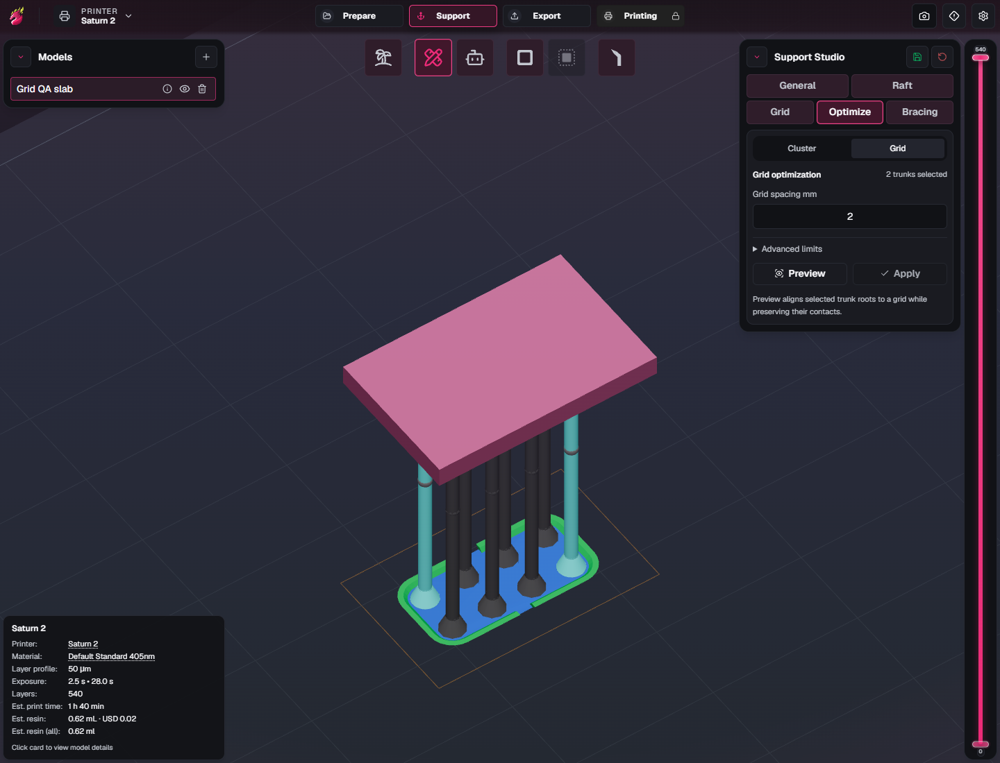
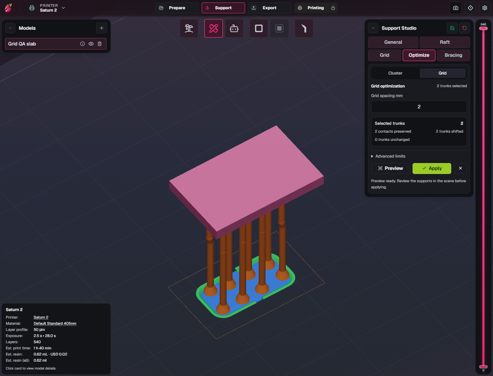
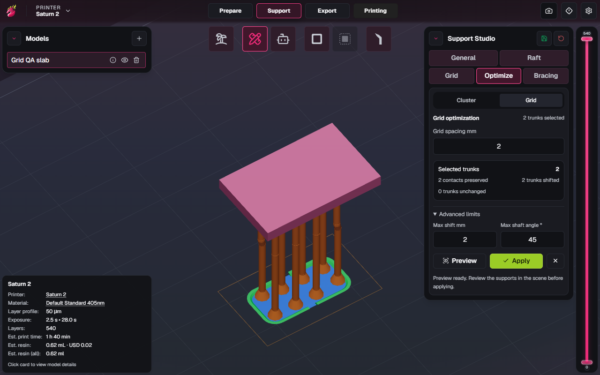

# Support Studio Stage 3: Grid Optimization acceptance

Status: **implemented; automated checks, optimized frontend browser review, and Windows x64/NSIS build passed; candidate ready for combined Stage 2/3 review and explicit user acceptance.** On 2026-10-16 the user instructed: “Proceed with Stage 3, I’ll review Stage 2 and 3 together”. This is an explicit exception to the normal sequence, not acceptance of Stage 2. Stage 1 remains accepted. Stage 4 is deferred until explicit acceptance after combined review. [Phase 0.5](upstream-0.1.17-acceptance.md) remains unaccepted; the package remains the unpublished 0.4.1 candidate. No release or version bump is authorized.

## Scope and agreed intent

Grid Optimization aligns the roots and lower shafts of explicitly selected grounded trunks to DragonFruit's existing zero-origin XY lattice. Preserve every existing model contact's position, orientation, contact-cone geometry, and profile. Reuse existing grid math, shaft/knot geometry, collision rules, and bracing contracts. Keep the selected model, active plate, and unrelated supports intact. Grid Optimization does not reduce or merge trunks; Cluster Optimization remains the separate reduction operation.

Support Studio's **Optimize** card offers **Cluster** and **Grid**. The existing **Grid** placement tab keeps its placement settings and behavior. Grid optimization controls and preview are temporary and add no persisted setting or scene schema. Preview is isolated; Apply commits a current proposal as one undoable graph replacement. Unsafe or unsupported candidates remain unchanged with a reported reason. Advanced Placement and support influence are outside this stage.

## Acceptance checks

Statuses distinguish completed synthetic automation, development/production browser review, and builds from pending native and broader manual scenarios. A planned manual check is not evidence of completion.

| Area | Required behavior | Status |
| --- | --- | --- |
| Lattice and selection | Selected eligible grounded trunks align root XY and vertical lower legs to the requested spacing using the existing zero-origin grid math. Negative coordinates and half-step ties agree with placement. No whole-model fallback or implicit trunk reduction/merge. Already aligned and empty/no-op selections remain unchanged. | Automated fixtures and development/production browser alignment passed; native review pending |
| Exact contacts | Compare all model contacts before/after, including position, normal/orientation, tip profile, diameter, penetration, socket identity, and contact-cone geometry. No model contact moves or disappears. | Automated exact-cone and codec checks passed; development/production browser contact counts preserved; native review pending |
| Broad geometry | Cover short/tall trunks, offset and already aligned roots, rotated/scaled model context, edge-of-plate roots, blocked preferred nodes, alternate nodes, cramped geometry, curved spans, and malformed/unsupported geometry. Safe cases align; unsafe cases skip without graph damage. | Automated short/tall, tiny shifts, bounds, blocked/alternate nodes, curved/malformed fixtures passed; rotated/scaled model and broader native/manual review pending |
| Dependencies | Preserve existing branches, leaves, knots, shared joints, and their world attachment positions or skip the trunk. Verify valid segment references and normalized attachment positions; protect kickstands, shared roots, and unsupported low attachments. | Automated branch/leaf/manual-brace world geometry and unsafe dependent checks passed; native/manual review pending |
| Node ownership | Respect occupied nodes from selected and unselected trunks, considering root and contact ownership. Do not overlap a second pillar or silently replace an existing owner. | Automated root/contact owners, alternate nodes, and competing selected roots passed; native/manual review pending |
| Bounds and collisions | Full root footprints remain within active plate bounds. Moved roots, lower legs, and diagonals respect model, neighboring model, support, brace, and root collision checks and length-aware angle rules. Bounded search reports failure without unbounded work. | Automated full-root bounds, shaft/root/brace and own/neighboring-mesh checks passed; native/manual review pending |
| Bracing | Preserve manual braces, links outside selection, shared knots, and kickstands. Regenerate only disposable automatic braces internal to affected selected trunks under the current Stage 1 sizing/pattern settings. Verify relative uniform diameters and both attachment endpoints. | Automated regeneration, stationary links, external links, Crosses preservation, and rejected-link cleanup passed; Grid-specific relative-size and native/manual review pending |
| Ownership | Reject mixed-model selections, inactive, locked or changed plates, and reassignment. Keep other models/plates and unselected graph entities intact. | Automated model/plate/lock guards passed; browser/native review pending |
| Preview lifecycle | Preview, repeated preview, Cancel, switching Cluster/Grid, leaving Optimize, and no-op/failure do not mutate committed graph, selection, settings, history, or serialized scene. Ephemeral geometry suppresses editing consistently with Cluster preview. | Controller, DOM, and development/production browser Preview/Cancel/tool-switching checks passed; native review pending |
| Staleness | Selection, graph, Undo/Redo, options, model mesh/transforms, active/model plate, plate bounds, or relevant bracing/grid context changes invalidate a proposal. Apply revalidates the full context and cannot commit stale geometry. | Controller/DOM checks passed, including locks/bounds and normalized settings; development/production browser option staleness passed; native review pending |
| Atomic history | Apply produces one typed support edit. One Undo restores the complete previous graph; one Redo restores the aligned graph with contacts/dependents/braces intact. Repeated cycles are stable; no-op and Cancel create no entry. | Controller/DOM checks and development/production browser Apply/Undo/Redo passed; native cycles pending |
| Save/reopen | Applied geometry survives ordinary binary VOXL save/parse/store reload with exact contacts, valid knots, ownership, and braces. Legacy scenes and Stage 1 settings remain compatible. Preview/options do not serialize. Distinguish codec automation from actual browser/native save/reopen. | Actual binary VOXL serialization/parse/store roundtrip passed; browser/native save/reopen pending |
| UI/localization | Cluster and Grid choices, numeric controls/units, summaries, skip/no-op/failure feedback, and disabled/stale states are usable at compact sizes. Extract and compile all catalog messages; test compact production IDs. Verify the existing Grid placement tab. | DOM/catalog/localization checks and development/production browser 1280 × 800 review passed; native review pending |
| Integration/build | Record core, controller, DOM, support/scene regressions, TypeScript, relevant lint/localization gates, docs accuracy, optimized frontend and any Windows build actually performed. Preserve Stage 2 behavior. | 915 support/VOXL unit tests, DOM, TypeScript, lint/localization/docs gates, and development/production browser checks passed; Windows x64/NSIS build passed; installation/native evidence pending |

## Checks actually performed

On 2026-10-16 an external synthetic browser fixture was prepared with the actual
trunk builder and binary VOXL codec: a centered 22 × 14 × 2 mm slab whose saved
transform places its underside at Z = 25 mm, with eight 1.2 mm grounded trunks.
Root/contact XY coordinates are deliberately offset from a 2 mm lattice.
Parsing confirmed eight trunks, eight roots, and an embedded 12-triangle mesh.
The pure Grid planner smoke run with 2 mm spacing, 2 mm maximum movement, 45°
maximum join angle, and ample plate bounds aligned all eight trunks, retained
eight contacts before/after, and returned no skips. This verifies fixture
preparation and a basic planner case only; it does not establish UI behavior,
Apply/history, save/reopen, broad geometry, native behavior, or physical printing.
The fixture and helper remain outside the repository.

Documentation accuracy passed for 169 documents after the planner and controller
interfaces were present. The documentation whitespace diff check also passed.

### Automated implementation evidence

The final focused core/controller run passed **53/53 tests**: **20 Grid planner**,
**16 Cluster planner**, **11 Cluster preview**, and **6 Grid preview** cases.
The independent review found and repaired three regression risks: releasing
stationary automatic braces during another root's move, accepting nonfinite
hosted knot coordinates, and pruning the intentional Crosses brace pattern.
The final fixtures verify the fixes, plus regenerated-link checks against the
retained forest and removal of unused new knots after rejected links.

Planner fixtures cover exact contact objects/IDs and unmodified input,
branch/leaf/manual-brace world positions, unsafe low attachments, shared roots,
kickstands, root/contact node ownership, competing selected roots, short and
tiny shifts, movement/angle/bounds refusals, full-diameter shaft/root/brace
collisions, own and neighboring meshes, no-op/repeated alignment, malformed
spans, model/plate exclusion, internal automatic-brace regeneration, and
external-brace preservation. The actual binary VOXL roundtrip runs support
export, binary serialization, parse, and store reload; it checks aligned roots,
exact contacts, and dependent graph geometry. These are synthetic application
contract checks, not native save/reopen or physical-print checks.

A synthetic selection of **1,500 separated off-grid roots** aligned in observed
pure-planner runs of approximately **124–136 ms**. The search is limited to nine
nearby nodes per root and 6000 geometry candidates per run. This records one
fixture's behavior and bounded search, not a general performance guarantee.

The final DOM run passed **11/11 tests**: ten optimization cases and the existing
Stage 1 auto-bracing case. Optimization coverage includes both tools, controls,
Preview/Apply/Undo, failures, normalized settings, Cluster/Grid option
preservation, plate locking, and bounds invalidation. The compiled production-ID
catalog regressions passed **12/12 tests** across all six locales for the two
optimization tools. Catalog extraction and compilation ran; new target-locale
messages remain untranslated for Crowdin. The localization literal gate passed
**62 paths / 166 files**. TypeScript and scoped ESLint passed with zero lint
warnings. The primary broad support/VOXL unit suite passed **915/915 tests**;
the routine lint gate passed **43 directories**. The shared preview refactor retains Cluster's dedicated API and its
regression coverage.

### Development browser evidence

The primary development-browser review exercised the actual Grid controls and
viewport with two selected trunks: both roots moved and both model contacts
were preserved. Preview, Cancel, switching tools (including a Cluster preview),
option-change staleness, Apply, Undo, and Redo passed. At **1280 × 800**, all
controls remained visible. The run reported **zero uncaught page errors**.
These are development-browser checks on the synthetic scene; they do not
establish production frontend, native installation/UI, or physical printing.

### Optimized frontend evidence

The optimized frontend build completed. The primary production-browser review
served the exact static assets prepared for embedding in the Windows application.
Grid passed actual viewport Preview, Cancel, tool switching, option-change
staleness, Apply, Undo, and Redo: two selected trunks shifted while retaining
their two model contacts. At **1280 × 800**, all controls remained visible.
The run reported **zero uncaught page errors**. The primary visually inspected
full-size and compact screenshots and found no raw catalog IDs or clipped
controls.

Cluster production regression review also passed Preview, Cancel, option-change
staleness, Apply, Undo, Redo, and the compact layout: seven selected trunks
reduced to four trunks while preserving seven contacts, with **zero uncaught
page errors**. This verifies the existing Stage 2 workflow after the shared
preview refactor; it does not mark Stage 2 accepted.

These images show the actual optimized frontend and synthetic scene. They
establish the recorded browser workflow, not native installation or print
strength.

### Windows candidate build

Source commit `27acd6a0` produced the optimized frontend and Windows x64
executable/NSIS installer successfully with exit code 0. The release compilation
completed in 4 minutes 48 seconds. PE machine type `0x8664` identifies x64;
ProductName is `DragonFruit (stickninja)`, CompanyName is `stickninja`, and
ProductVersion remains `0.4.1`.

The local combined-review candidate is named
`DragonFruit-stickninja-grid-stage3-x64-setup.exe`, **21,987,643 bytes**, with
SHA-256 `B6F8C10B87EC934B1727F863F5D1CACFF1C4C880C11C072A7F212DD848128B24`.
The copied review artifact's hash matches the built installer. Documentation and
screenshots follow separately; the candidate's application source is the commit
above. This is an unpublished build for combined Stage 2/3 review. Installation,
native UI, remaining detailed manual scenarios, and physical printing have not
been independently verified. No release or version bump was performed.

### Follow-up: idle Preview eligibility

After the candidate above was built, user review reported a blocked Preview
with idle help text and a separate automatic support-generation failure.
Investigation confirmed that the optimization cards did not subscribe to mesh
registration until a preview existed. Opening Optimize before model geometry
registered could therefore leave Preview disabled after the geometry became
available.

Both Cluster and Grid cards now observe mesh registration while idle, using the
existing eligibility getter and retaining the selection/model/plate/lock guards.
Apply is also disabled when current eligibility fails. The focused compiled DOM
suite passed **13/13 tests**. New Cluster/Grid mesh-arrival and removal cases
failed before the fix and passed after it. A Cluster zero-to-one-to-two-trunk
selection case passed before the fix and remains a selection sanity check;
it does not reproduce the mesh-registration defect. TypeScript, scoped ESLint,
and the localization literal gate passed for the follow-up.

Source commit `261181db` includes the idle-eligibility fix. The primary review
of its optimized frontend passed Cluster selection after the card mounted,
Preview, Cancel, option-change staleness, Apply, Undo, Redo, and compact layout:
four selected trunks reduced to three retained trunks with four contacts
preserved. Grid's full browser workflow also passed with two trunks moved and
two contacts preserved. A Windows build of that source completed, but was
superseded by the separate dense-candidate correction below; it is not the final
replacement package.

These checks establish the confirmed idle-eligibility defect and synthetic
browser workflow. The cause of the user's actual blocked Preview has not yet
been verified in native use; this change has not been shown to resolve every
reported symptom.

### Follow-up: dense automatic-support candidates

A separate synthetic regression reproduced a numeric-maximum `RangeError`
with **652,392 minima**. Source commit `0a7334fa` replaces array-spread
maximum calculations for candidate height and area during scoring, and maximum
height in sizing diagnostics, with bounded-argument iteration. The same dense
fixture passed after the correction. The focused candidate-generation suite
passed **17 tests**, and worker/related coverage passed **14 tests**. This
confirms the dense scoring/diagnostics overflow and its correction; it does not
establish completion of a support-generation run on the user's actual model.

Native UI observation confirmed About displays upstream **0.1.17**, fork
**stickninja r1**, with the current preset enabled and a reported **652,392
minima**. The actual native Preview cause and user-model retest remain pending.

The Windows x64/NSIS build from `0a7334fa` completed successfully but is
superseded by the final replacement package below.
The earlier installer/hash above remains historical evidence for `27acd6a0`
and excludes the follow-up fixes.

### Follow-up: duplicate-position minima connectivity

A separate synthetic native scan found different minima counts for equivalent
cube geometry: eight shared vertices and twelve faces produced **one minimum**,
while thirty-six per-face vertices with the same twelve faces produced **ten
minima**. Welding exact duplicate positions in the analysis copy produced
**one minimum** for each representation.

The native correction uses the existing core connectivity groups on a private
analysis copy with exact duplicate positions welded. It preserves the original
source/world coordinates, face order, and original vertex references. Five
native module tests passed in an isolated harness, and the targeted full desktop
Rust tests passed **5/5**. The correction is committed in source `199f9bf2`
(full commit `199f9bf2c8dbf377e77188fde1e2069cc4968e07`).

The user's private 3MF has not been inspected, so the synthetic duplicate-index
case does not establish the cause of that file's reported minima count. Review
of the user-provided screenshot showed enabled-looking Preview,
disabled-looking Apply, and idle help text. The image does not establish actual
control eligibility, cursor state, or the cause of the reported interaction.
Native Preview behavior and a complete run on the user's actual model remain
pending.

### Final follow-up Windows candidate

Source `199f9bf2` built the final Windows x64 executable and NSIS installer
successfully with exit code 0. Rust release compilation took 4 minutes 45 seconds;
this is the compilation stage duration, not total build time. The executable's
PE machine type is `0x8664`, ProductName is `DragonFruit (stickninja)`, and
FileVersion/ProductVersion remain `0.4.1`.

The replacement review candidate is
`DragonFruit-stickninja-support-fixes-199f9bf2-x64-setup.exe`, **21,995,851 bytes**,
SHA-256 `98F113290C897975414652771A3CA3125578423EDC5110F138866F453D6BE35C`.
The built and copied review artifacts have matching hashes. This package includes
the idle mesh-eligibility, dense scoring/diagnostics overflow, and native
minima-connectivity fixes. Installation and launch verification are recorded
below. Native Preview verification and a complete user-model run remain pending.
No release or version bump was performed.

### Installation and launch of the follow-up candidate

The user confirmed the scene was saved and the application closed; the native
window list then confirmed no DragonFruit window remained. The silent NSIS
installer completed with exit code 0. The installed executable identifies as
`DragonFruit (stickninja)`, version `0.4.1`, **35,382,272 bytes**, SHA-256
`9E22966389CA9442565DA4F18ECBE29FD87BCC6978CA4286DBA1A95F6F6D4302`.
Byte comparison with the built executable matched except for the expected
three-byte Tauri bundle marker change from `UNK` to `NSS` made by NSIS packaging.

The installed application reopened in a native window and displayed upstream
**0.1.17**, fork **stickninja r1**. The saved scene opened, and Support Studio's
Optimize controls were visible. Control was left with the user when interaction
was detected. No new scan, support-generation run, or native optimization Preview
was performed during this check. Those behaviors remain pending; this evidence
does not establish shortcut, file-association, official-installation, or
profile-byte preservation checks.

### User retest after installation

The user confirmed automatic support generation works on the installed corrected
candidate and reported that Optimize still does not work. This is user-confirmed
generation behavior; it does not establish all topology, support-quality, or
physical-print acceptance checks.

Native review with ten selected trunks showed Preview enabled, Apply disabled,
and the idle helper. An attempted click was inconclusive because window movement
and cleared selection prevented a reliable interaction result. It is not recorded
as a passing Preview check and does not establish the cause. Native Optimize
behavior remains unresolved and requires further investigation.

### Follow-up: marquee-selected root ownership

Further native review with eight selected trunks displayed a model-selection
error. Investigation confirmed marquee selection also emits root IDs, while the
shared optimization guard looked only through support-type collections that
exclude roots. A valid same-model trunk-and-root selection was therefore
incorrectly rejected.

The correction uses the canonical entity-owner resolver for every selected ID,
accepting same-model roots and support parts while targeting only selected
trunks. The complete selection still participates in preview invalidation;
unknown or differently owned entities retain their guards.

Verification passed **27 controller/resolver tests** and **15 compiled DOM tests**.
Independent review also passed the 27 unit tests and two new DOM regressions,
plus ephemeral checks for both tools using same-model roots and trunks through
Preview, Apply, and a single Undo. Primary scoped lint and documentation checks
passed, and the frontend build passed with type checking. These checks establish
the selection-ownership correction in synthetic fixtures; they do not establish
native behavior. The four new unit and two DOM regressions failed before the
fix with the model-selection error and passed after it.

Actual pointer interaction in the optimized production frontend passed with
Optimize opened before selection. A right-to-left marquee included eight trunks
and visibly selected feet. Cluster reduced eight trunks to five, preserved eight
contacts, and reported three fewer trunks with two legitimate geometry skips.
Grid shifted all eight trunks, preserved eight contacts, and reported zero
unchanged trunks. Preview, Cancel, stale-limit feedback, and Apply passed for
both tools. Undo/Redo actions and screenshot review completed; this is visual
browser evidence, not a byte-for-byte browser history comparison. The primary
reviewed the Cluster preview and Grid applied screenshots. The run exited
successfully with zero uncaught page errors.

Windows native packaging is still in progress. A native retest is pending;
the current native Optimize issue is not recorded as passed.

## Remaining acceptance boundary

Stage 2 and Stage 3 require explicit user acceptance after the combined review. Successful automated tests or a build do not establish native pointer behavior, installation, physical print strength, or hardware performance. No physical-print claim is made. See the [fork roadmap](fork-roadmap.md) and [Stage 2 record](support-studio-cluster-acceptance.md).
